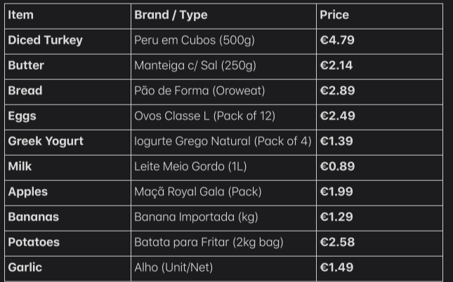
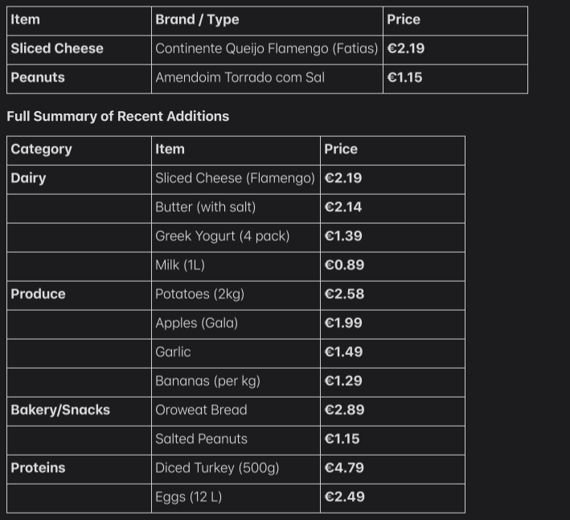

Continente
Updated Shopping Inventory & Prices
Here are the items from your latest photos, including the specific prices from the Continente labels:

Consolidated Price List (Previous Items)
To keep everything in one place, here are the prices visible on your earlier freezer photos:
Chicken Thighs: €3.07 (€5.29/kg)
Chicken Stroganoff: €4.67 (€9.79/kg)
Pork Belly: €2.69 (€5.49/kg)
Fresh Ginger: €1.06 (€4.99/kg)
Budget Note: Just a heads up, your protein costs (Chicken, Pork, and Turkey) make up the largest portion of your spending so far. With the eggs and yogurt added, you have a very high-protein pantry!
Inventory Update: Snacks & Dairy
Adding the final items from your latest photos:

You've got a great mix of quick snacks (peanuts, bananas, apples) and sandwich essentials (bread, cheese, butter).
Quick tip: Since you have the pork belly and potatoes, you're halfway to a killer roast, or you could use that ginger and turkey for a fresh stir-fry. Need a recipe to tie these all together?
